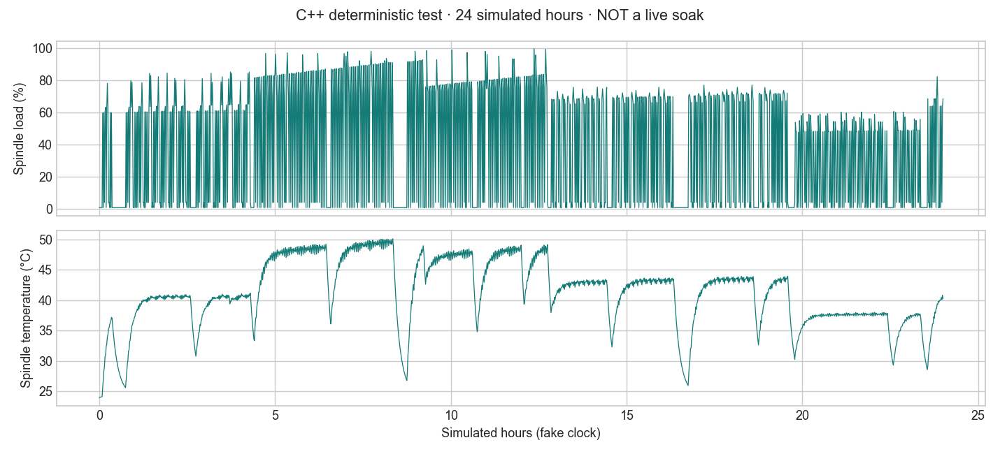
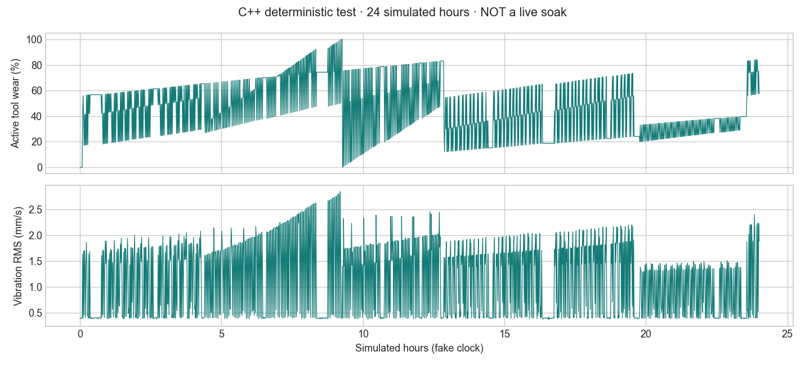
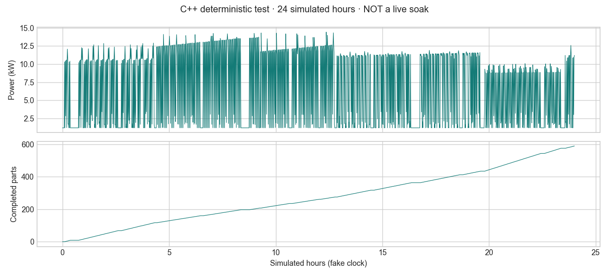
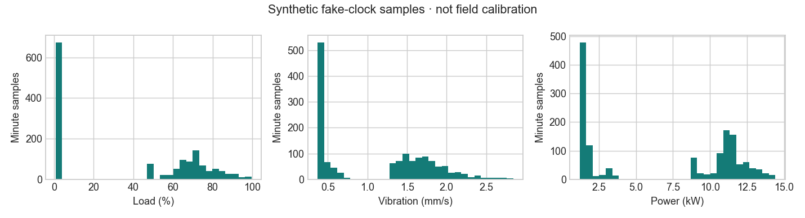

# Actual verification report — 2026-11-01

**Implementation runs; full 24-hour acceptance is pending. 24h soak = NOT RUN.** No fake-clock run below is a live soak. No 24-hour RAM guarantee is inferred from a short measurement.

Environment: macOS host, Docker Desktop Engine 29.5.3, Linux arm64 containers; C++17/GCC 12, open62541 1.5.0, pinned Snap7 commit, libmosquitto 2.0.11, broker Mosquitto 2.1.2, SQLite 3.40.1. Independent clients: python-snap7 2.0.2, asyncua 1.1.5, paho-mqtt 2.1.0 on Python 3.12. SBOM files record exact installed package revisions. Times in raw evidence are UTC; local user date is Europe/Istanbul 2026-11-01.

## Commands and results

| ID | Actual command / method | Timestamp | Result | Measured evidence / limitation |
|---|---|---|---|---|
| T01 | `scripts/test-all.sh` → `cmake -S . -B build -G Ninja && cmake --build build -j2` in `cnc-dependencies` | 2026-11-01 | PASS | Linux C++ runtime and tests compile. [Log](evidence/test-all.log) |
| T02 | `docker compose up -d --build` | 2026-11-01 | PASS | Exactly two production services, healthy; host 127.0.0.1 ports 102/4840/1883/8080 |
| T03 | `scripts/smoke-connectors.sh` | 2026-11-01 08:20 UTC | PASS | DB1..4 lengths 256/256/256/128; all fields decoded with independent Python `struct`; slots 0 and 1 |
| T04 | Same external-client script | same run | PASS | All 158 fields matched at sequences **33409, 33410, 33411**, REAL tolerance 1e-3; encrypted UA reads + subscription and MQTT schema validation. [Delivered-image log](evidence/delivered-connectors.log) |
| T05 | C++ deterministic CTest | 2026-11-01 | PASS | 100,000 fake-clock ticks, SETUP/RUNNING/TOOL_CHANGE/IDLE and completed production |
| T06 | C++ idle-wear/accelerated-life tests | same run | PASS | No idle wear drift; 80/95/100% events; immediate hard stop at limit, including preemption of a sensor warning |
| T07 | C++ 17-fault matrix; isolated `tests/e2e/admin.py` | 2026-11-01 | PASS | Timed recovery; stop/feed interlocks; sensor warning continues NC time; admin E-stop and acknowledgement. [Log](evidence/admin.log) |
| T08 | C++ 1,000 completed-cycle stress | same run | PASS | Work-order changes and setup; job good+reject=completed; overall counters invariant |
| T09 | `.venv312/bin/python tests/e2e/recovery.py` | 2026-11-01 08:05 UTC | PASS | Real Compose stop/start: exact persisted counts/order/wear, nondecreasing energy/sequence, restart event; no incomplete part added. C++ recovery from eight states. [Log](evidence/recovery.log) |
| T10 | C++ SQLite fake-clock retention test | 2026-11-01 | PASS | Expired telemetry/events/completed orders removed at 24h+60s; active order and persistent runtime record retained |
| T11 | C++ store/HTTP external checks; `stream-memory` | same run | PASS | SQL-backed bounded history, strict query limits; 5,000 rows streamed (20,185,001 bytes), max chunk 20,185 bytes, peak process RSS **7,808 KiB**. Real HTTP 5,000-row response: 22,427,909 bytes, 1.235 s. [HTTP log](evidence/history-5000.log) |
| T12 | `tests/e2e/recovery.py` broker stop/start | 2026-11-01 08:05 UTC | PASS | Engine/DB continued; sequence advanced by 6 during outage, MQTT reconnected; retained/state subscription rechecked by protocol test |
| T13 | Live 24-hour 3×3-client soak | — | **NOT RUN** | Short loaded measurement reported separately below; not a 24h acceptance pass |
| T14 | `scripts/soak.sh 300` | 2026-11-01 08:20–08:25 UTC | PASS (shared-host measurement) | 300.11 s; 3 clients/protocol; average CPU 0.936% of one core; loaded peak RSS 23.906 MiB |
| T15 | `tests/e2e/admin.py`, `tests/integration/security.py`, connector HTTP negative tests | 2026-11-01 | PASS | Default admin 404; wrong/missing auth 401; malformed JSON/query 400; rate limit 429. OPC None session, anonymous MQTT and observer publish denied. [Security log](evidence/security.log) |
| T16 | Per-snapshot C++ contract/physics checks | 2026-11-01 | PASS | Finite ranges, cut interlocks, nondecreasing energy, power integral error <1%, XYZ derivatives; bounded spindle acceleration |
| T17 | C++ stress test | same run | PASS | 1,000 completed cycles, deterministic seeded replay, legal state transitions and valid counter/range checks |
| T18 | Real in-app browser inspection, HTTP static assets | 2026-11-01 | PASS | Live dashboard, 12 tools, six 24h-window charts, events/orders/OEE; no CDN. [Inspection](evidence/ui-inspection.txt) |
| T19 | Independent S7 `db_write`; independent UA write | 2026-11-01 08:20 UTC | PASS | Both rejected; S7 model/DB counter not overwritten. Expected Snap7 “Item not available” log is the rejection evidence |
| T20 | Compose, secret mounts, notices and source review | 2026-11-01 | PASS / scope | Non-root, cap_drop ALL, read-only rootfs, localhost bindings, generated ignored secrets, source/license notices. No claim of formal security or license certification |
| Extra | `.venv312/bin/python tests/e2e/disk_fault.py` | 2026-11-01 | PASS | Actual ENOSPC on isolated 1MiB tmpfs: `database or disk is full`; engine kept publishing; 3 failed commits recorded; freeing reserve restored writes. [Log](evidence/disk-full.log) |

## Resource measurements

The final delivered runtime completed **300.11 seconds** of loaded measurement, with **31 samples**, from 08:20:58 to 08:25:58 UTC (11:20:58–11:25:58 Europe/Istanbul). RSS counts the simulator and broker main processes from `/proc/*/status`; CPU uses both processes' user+system ticks (`CLK_TCK=100`), divided by elapsed seconds and one core. Test clients and build processes are excluded. The host is a shared Docker Desktop VM; the CPU number is normalized to one core, not a dedicated single-vCPU host benchmark. Three independent S7 clients, three encrypted OPC UA subscription clients, and three MQTT subscribers were connected. The dashboard may also poll.

`docker stats` is a separate cgroup view and is not interchangeable with process RSS: shared mappings and cache accounting differ. One actual sample was simulator 7.312 MiB / broker 3.855 MiB in that view, while process RSS summed to about 24 MiB. [Cgroup sample](evidence/cgroup-sample.txt).

| Measurement | Actual result |
|---|---:|
| Initial simulator + broker RSS | 23.891 MiB |
| Final RSS at 300.11 s | 23.730 MiB |
| Peak sampled RSS | 23.906 MiB |
| Mean process CPU, one-core normalized | 0.936% |
| Samples / interval | 31 / approximately 10 s |
| Short-run ≤100 MiB target | PASS |

[Raw process measurements](evidence/resources-5min.csv), [machine-readable summary](evidence/resources-5min-summary.json), [three clients per protocol](evidence/loaded-clients.log), [measured image ID](evidence/measured-image.txt).

Kernel high-water RSS recorded after testing: simulator **16.840 MiB**, broker **7.262 MiB**. Their sum **24.102 MiB** is a sum of individual process lifetime maxima, not a simultaneously observed combined peak. [Simulator HWM](evidence/simulator-high-water.txt), [broker HWM](evidence/broker-high-water.txt).

The small Docker init process is excluded from the two main-process RSS series; its separately captured RSS was 464 KiB in an earlier loaded sample. The final complete process tree is also recorded [here](evidence/process-rss-sample.txt). No unseen transient peak or long-run bound is asserted.
 **1h RSS = NOT RUN; 24h RSS = NOT RUN.** No sustained-leak conclusion is drawn. The SQLite file had accumulated roughly 29 MiB after several hours of runtime; this is not a 24h maximum-disk proof. WAL checkpoint/retention behavior and bounded query memory were exercised separately.

## Fixed defects and honest scope

The work initially encountered and corrected: unavailable Docker daemon; Snap7 integer handle mismatch; illegal material-wait/feed-hold/restart transitions; warning faults freezing NC time; stop-tick cutting flag inconsistency; YAML integer type mismatch; failed-commit rollback handling; oversized history materialization; overly broad secret mounts; Docker internal-network port-publishing behavior. A focused audit reproduced the original history path at 136,024 KiB peak RSS; the streamed path measured 7,808 KiB in the final C++ test. The initial streaming transport was too slow for a 5,000-row response within its 3-second deadline; bounded multi-chunk pumping corrected that, and the independent HTTP test completed all 5,000 rows in 1.235 seconds. A final hard-limit test also covers a 100% tool limit preempting an existing sensor warning.

No real PLC was connected or scanned. Python clients are independent test processes only. Unknowns remaining: full 24-hour loaded memory/liveness acceptance, field calibration, exhaustive browser/security testing. Full synthetic 24-hour plots below come from **accelerated C++ test samples**, not from real-time operation or measurements from a physical machine.

## Statistical diagnostics (synthetic, accelerated)

Actual first-24-simulated-hour traces were stratified by program, tool and 100-rpm bucket, using cutting-only samples with at least 20 observations and at least one percentage point of wear range. Sample-weighted correlations were **wear/load r=0.9346** and **wear/vibration r=0.9535**. One brass-drill stratum (program 1004, tool 8, n=21) had **wear/load r=-0.2433**; an all-strata positive-correlation pass is **not** claimed. These are model diagnostics, not a real-world realism certification. [Full group results](evidence/synthetic-correlations.json).

## Actual synthetic test figures

Reproduce figures with `scripts/plot-test-traces.py` and Matplotlib 3.10.0 after `scripts/test-all.sh`. The data source is `logs/synthetic-traces.csv` generated by the actual C++ tests. These plots are diagnostics, not a proof that synthetic data is indistinguishable from real CNC data.

## Live Docker deployment verification (2026-11-02, Europe/Istanbul)

Linux x86_64 Docker build completed, including the C++ tests. Production uses an isolated Compose project with two healthy containers; the shared reverse proxy provides authenticated HTTPS and native MQTT TLS with SNI. S7 and encrypted OPC UA were tested through SSH loopback forwards; admin remains disabled.

Actual external verification command: `.venv312/bin/python /tmp/cnc-live-test.py` (deployment workstation, independent python-snap7, asyncua and Paho clients; generated credentials fetched over SSH into memory). Result: **PASS**, all 158 CSV fields matched across S7/OPC UA/MQTT at sequences **427, 429, 430**; HTTPS history returned stored data and admin returned 404. TLS certificate verification was enabled using certifi. Authenticated GET results: `/` **200 / 1560 bytes**, `/app.js` **200 / 4339 bytes**, `/style.css` **200 / 2188 bytes**. These checks caught and corrected non-root configuration/static asset permissions in the Docker image. CI now checks that all three static assets are nonempty.

Private deployment commands, topology and raw results are retained on the host in `OPERATIONS.md` and `DEPLOYMENT_TEST.log`; credentials are excluded from Git. **24h soak = NOT RUN**; short integration checks do not establish the 24-hour RSS acceptance criterion.
